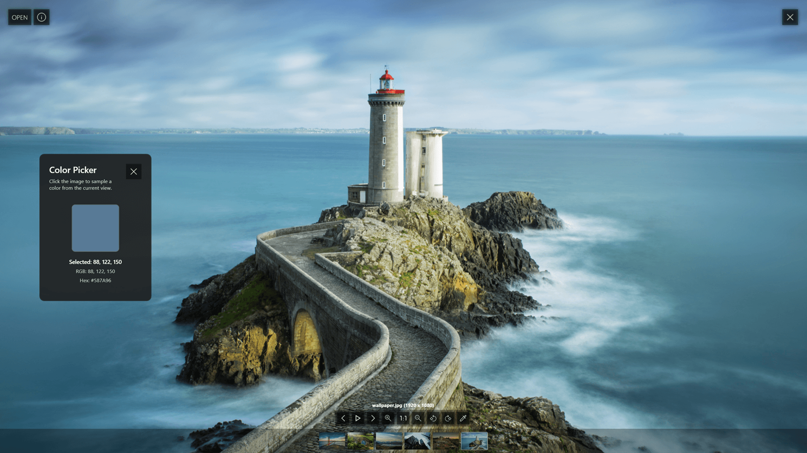

    

# 🖼️ Picasso Image Viewer

A powerful local image viewer for Windows made with C#. It supports `JPG`, `JPEG`, `PNG`, `GIF`, `BMP`, `ICO`, `TIFF` and `WMF` formats.

## Usage

Picasso can be launched by:
- Double-clicking the executable and selecting image files.
- Selecting image files or folders and using the Send to option in Windows Explorer.
- Running it from the command line - `picasso.exe C:/Users/Richard/Pictures/wallpaper.jpg`.

## Features

- **Drag and drop support** — Open image files by dragging them into the app.
- **Print (Ctrl + P)** — Print the currently opened image.
- **Open (Ctrl + O)** — Select and open image file from your computer.
- **Slideshow** — View images in a full-screen slideshow.
- **Navigation** — Move quickly between images in a folder.
- **Zoom** — Zoom in and out for a closer view.
- **Rotation** — Rotate images left or right.
- **Color picker** — Pick colors directly from the image.

## How to Install?

Build the app from source, or download a prebuilt version from the [releases page](https://github.com/richardDobron/Picasso-Image-Viewer/releases).

## License

This project is licensed under the MIT License. See the [LICENSE](LICENSE) file for details.
